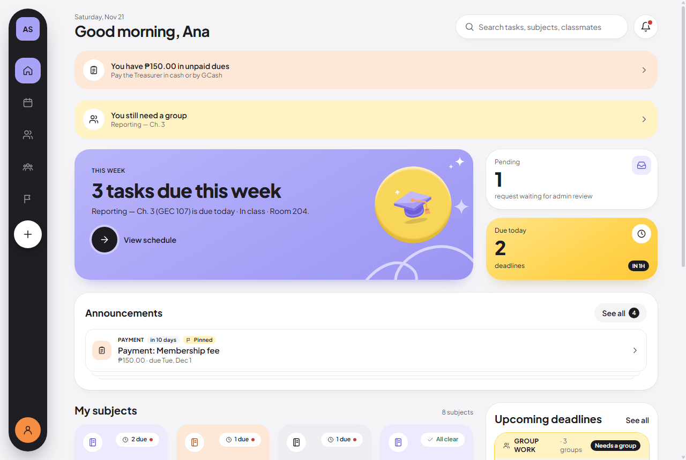
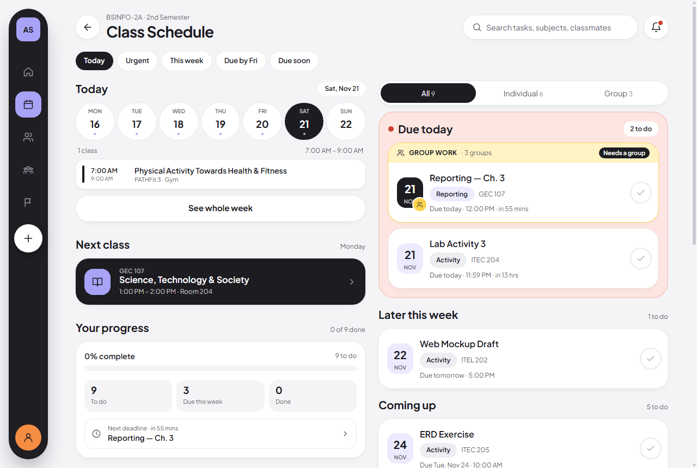
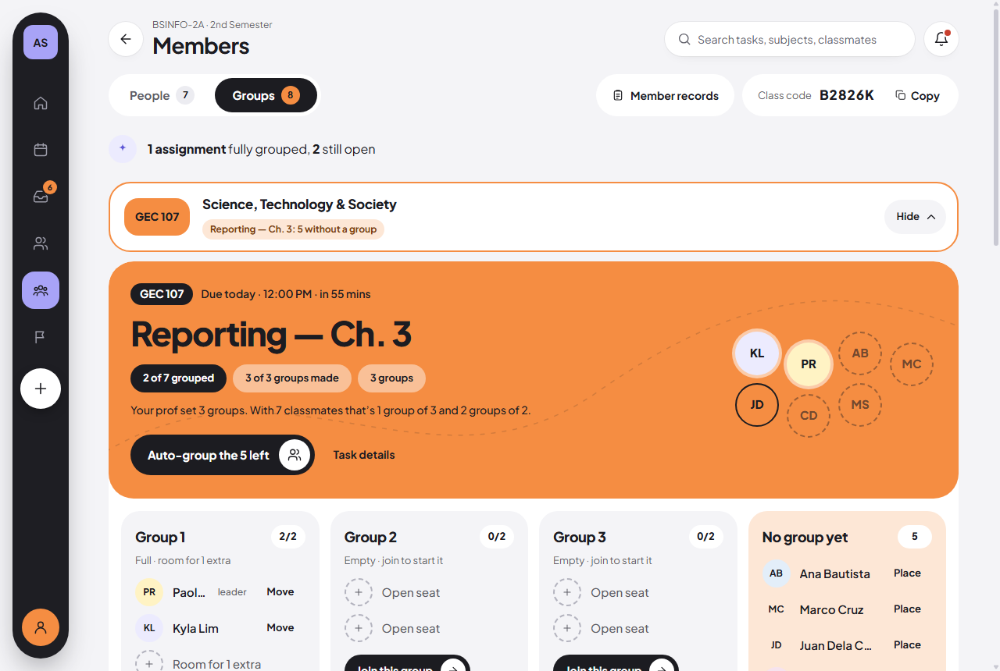
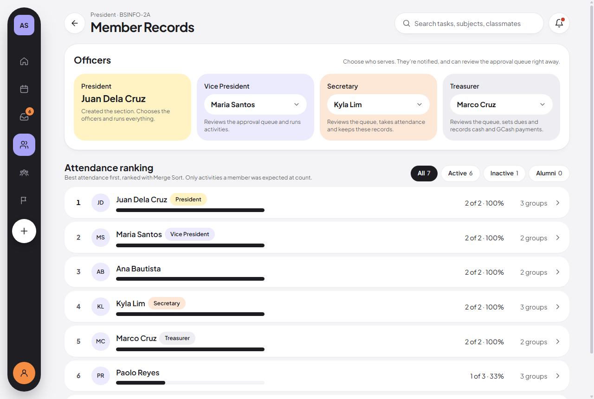
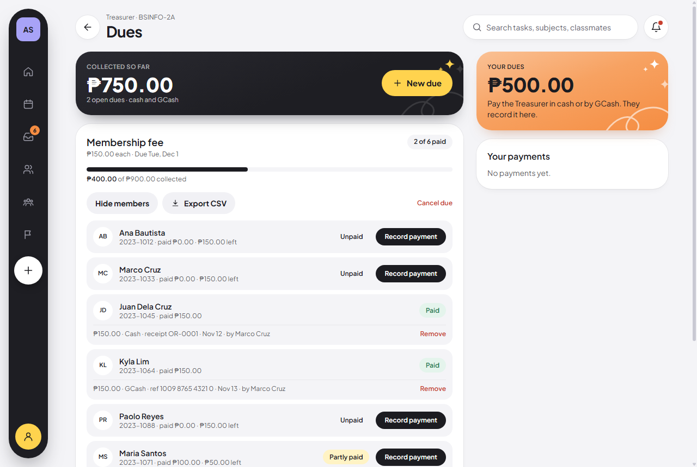
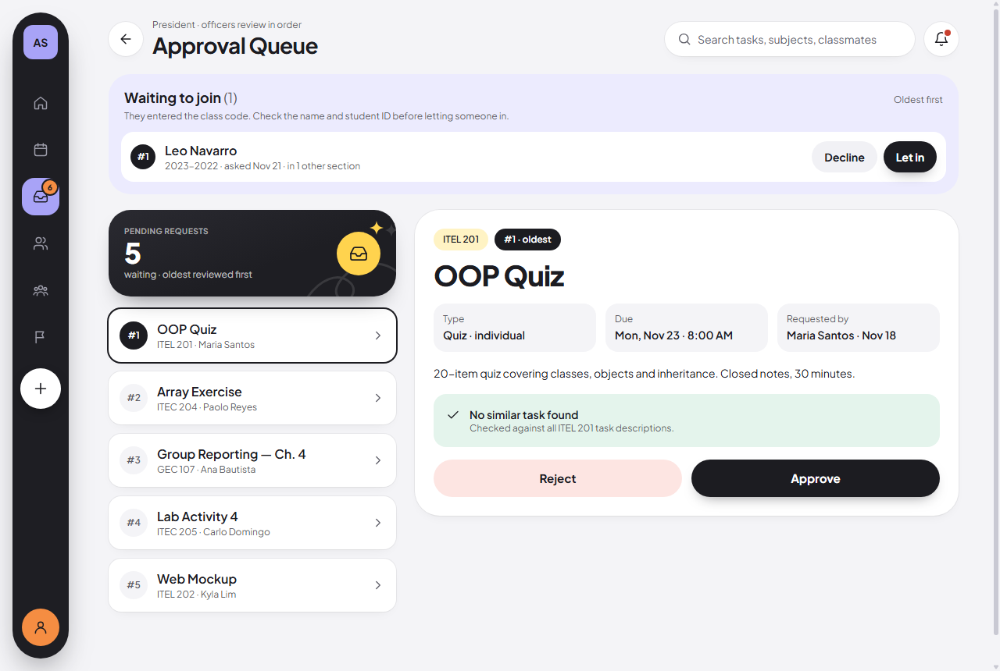

<div align="center">

# AcadSync

**A student organization management system for LSPU class sections.**

Membership · Officers · Activities & attendance · Competitions & section projects · Member records · Tasks, schedule & group work


</div>

---

## Table of contents

1. [Overview](#overview)
2. [Project objectives](#project-objectives)
3. [Team and submission links](#team-and-submission-links)
4. [Screenshots](#screenshots)
5. [Quick start](#quick-start)
6. [Configuration](#configuration)
7. [Demo accounts](#demo-accounts)
8. [Features](#features)
9. [Object-oriented design](#object-oriented-design)
10. [Data structures and algorithms](#data-structures-and-algorithms)
11. [Tests](#tests)
12. [Reading the database](#reading-the-database)
13. [Project layout](#project-layout)

---

## Overview

AcadSync treats each class section as a student organization. Anyone can create a section and lead
it as **President**; classmates ask to join with a class code and an officer lets them in. Members
take part in activities, pay dues, read announcements, and share the class's tasks, schedule and
group work.

It was built for two final requirements at LSPU (BSINFO-2A):

- **Object-Oriented Programming, Scenario 1: Student Organization Management System**: the four
  pillars, real classes with constructors and access modifiers, meaningful relationships, and a UML
  class diagram that matches the code.
- **Data Structures and Algorithms**: seven hand-written data structures and six sorting and
  searching algorithms, each used for a real feature.

| Layer | Built with |
| --- | --- |
| Frontend | HTML, Tailwind CSS, vanilla JavaScript |
| Backend | PHP 8, designed around the **four pillars of OOP** ([`backend/domain/`](backend/domain/)) |
| Data structures | Every structure hand-written in [`backend/custom_dsa.php`](backend/custom_dsa.php) |
| Storage | SQLite |

📐 **Class diagram and OOP pillars:** [docs/CLASS_DIAGRAM.md](docs/CLASS_DIAGRAM.md)
🧮 **Data structures and algorithms:** [see below](#data-structures-and-algorithms)

---

## Project objectives

1. **Run a section like an organization.** Give each class section a President, officers they
   appoint (Vice President, Secretary, Treasurer) and members, each with clear permissions.
2. **Keep membership controlled.** Classmates ask to join with the class code; officers let them in
   first-come, first-served, and every member has a status (Active, Inactive, Alumni).
3. **Track participation.** Schedule meetings, seminars and outreach, take attendance with a rule per
   kind of activity, and rank members by attendance in their records.
4. **Handle the organization's money.** Let the Treasurer set dues and record cash and GCash payments,
   so every member can see what they owe.
5. **Keep everyone informed.** Officers post announcements; members are notified of everything that
   concerns them.
6. **Support the class's academic work.** Share tasks, deadlines, the class schedule, group work and
   checklists, with requests reviewed in an approval queue.
7. **Show the course concepts in working code.** Apply the four OOP pillars in `backend/domain/`, and
   use every hand-written data structure and algorithm for a real feature, with no SQL sorting or
   filtering.

---

## Team and submission links

> [!IMPORTANT]
> Fill in this section before submitting. Groups are exactly 3 members.

| Member | Student ID | Role in the project | What they did |
| --- | --- | --- | --- |
| _Name_ | _0000-0000_ | _e.g. Backend and OOP model_ | _…_ |
| _Name_ | _0000-0000_ | _e.g. Frontend and design_ | _…_ |
| _Name_ | _0000-0000_ | _e.g. Data structures, testing and docs_ | _…_ |

| Deliverable | Link |
| --- | --- |
| 🎬 YouTube demo | _add link_ |
| 🖼️ Canva slides | _add link_ |
| 💻 GitHub repository | <https://github.com/rcldvmnl/AcadSync> |
| 📐 UML class diagram | [docs/CLASS_DIAGRAM.md](docs/CLASS_DIAGRAM.md) |

---

## Screenshots

Taken from the demo data (`SEED_DEMO_DATA=true`).

| Home (member) | Schedule |
| --- | --- |
|  |  |
| **Groups** | **Member records (President)** |
|  |  |
| **Dues (Treasurer)** | **Approval queue (officer)** |
|  |  |

---

## Quick start

**Requirements:** PHP 8.1+ with the `pdo_sqlite` extension (XAMPP's `php.exe` works).

```bash
# 1. Create your own settings file from the template (once)
copy .env.example .env          # Windows
cp .env.example .env            # Mac / Linux

# 2. Start the server from the project folder, WITH the router
C:\xampp\php\php.exe -S localhost:8000 router.php
```

Then open **<http://localhost:8000>**.

- The database is created on the first request, with demo data unless `.env` says otherwise.
- To start over, delete `data/acadsync.db`.
- The styles are a ready-built file (`Frontend/css/tailwind.css`), so the app works offline and needs
  no Node.js. **Only when you add or change Tailwind classes** in a page or script, rebuild it:

  ```bash
  npm install          # once: installs the Tailwind CLI (3.4.17) into node_modules/
  npm run build:css    # or: npm run watch:css while you work
  ```

  The theme (colours, font, shadows) is in `tailwind.config.js`. Commit the rebuilt `tailwind.css`.

> [!WARNING]
> **Always start the server with `router.php`.** Without it, PHP's built-in server serves every file
> in the folder, so anyone who can reach your computer could download the database or read `.env`.
> On Apache (XAMPP `htdocs`), the `.htaccess` files do the same job.

---

## Configuration

### Settings (`.env`)

| Key | Default | What it does |
| --- | --- | --- |
| `APP_ENV` | `local` | `production` hides error details from users (they are still written to the PHP error log) |
| `APP_TIMEZONE` | `Asia/Manila` | Timezone for deadlines, activities and notifications |
| `DB_PATH` | `data/acadsync.db` | Location of the SQLite file: relative to the project, or a full path (safest: outside the project) |
| `SEED_DEMO_DATA` | `true` | A brand-new database gets the demo section and accounts. Set `false` for a real class |
| `SHOW_RESET_CODE` | `true` | "Forgot password" also shows its code on screen, but only to a browser on the same computer (local demo). Set `false` once e-mail works |
| `MAIL_HOST`, `MAIL_PORT`, `MAIL_ENCRYPTION` | empty, `465`, `ssl` | The SMTP server that e-mails the reset code (`smtp.gmail.com`, `465`, `ssl` for Gmail; `tls` = STARTTLS on 587). Empty host = no e-mail |
| `MAIL_USERNAME`, `MAIL_PASSWORD` | empty | The sending account. For Gmail, `MAIL_PASSWORD` is an **app password** (Google Account → Security → App passwords, needs 2-Step Verification), never the normal password |
| `MAIL_FROM`, `MAIL_FROM_NAME` | `MAIL_USERNAME`, `AcadSync` | The sender shown in the e-mail |
| `SESSION_SECURE_COOKIE` | `false` | Set `true` once the site runs on HTTPS |

With neither e-mail nor `SHOW_RESET_CODE`, "Forgot password" says that reset isn't set up yet instead of
pretending a code was sent.

### What never goes to GitHub

`.gitignore` keeps these files on each computer only:

| File | Why |
| --- | --- |
| `.env` | Your personal settings. The team shares **`.env.example`** instead, which has no secrets |
| `data/*`, `*.db`, `*.sqlite` | The database holds every account, password hash and record |
| Logs, backups, `.taste-skill/` | Local output only |

Each teammate runs their own copy with their own database. To share demo data, everyone starts from
the same seed (`SEED_DEMO_DATA=true`) rather than committing a database file.

---

## Demo accounts

🔑 Password for every account: **`password123`**

Log in with the **e-mail**, the **student number** or the **username**. E-mails follow the format
`0000-0000@lspu.edu.ph`, where the part before `@` is the Student ID.

| Account | Role in BSINFO-2A | E-mail | Username |
| --- | --- | --- | --- |
| Juan Dela Cruz | **President** (created the section) | `2023-1045@lspu.edu.ph` | `juan.delacruz` |
| Maria Santos | **Vice President** (also a member of 2B) | `2023-1071@lspu.edu.ph` | `maria.santos` |
| Kyla Lim | **Secretary** | `2023-1064@lspu.edu.ph` | `kyla.lim` |
| Marco Cruz | **Treasurer** | `2023-1033@lspu.edu.ph` | `marco.cruz` |
| Ana Bautista | Member | `2023-1012@lspu.edu.ph` | `ana.bautista` |
| Carlo Domingo | Member, **Inactive** (on leave) | `2023-1051@lspu.edu.ph` | `carlo.domingo` |
| Bea Garcia | President of BSINFO-2B | `2023-2010@lspu.edu.ph` | `bea.garcia` |
| Leo Navarro | Member of 2B, **waiting to join 2A** | `2023-2022@lspu.edu.ph` | `leo.navarro` |

| Section | Class code |
| --- | --- |
| BSINFO-2A | **`B2826K`** |
| BSINFO-2B | **`K7Q4PM`** |

> [!NOTE]
> The officers, activities (including the *Founding Anniversary* competition and the *Booth design*
> project), dues, announcements and Leo's join request come from the seed, so they
> only appear in a **new** database. In an older database, the President picks the officers on the
> **Member Records** page.

---

## Features

### 👥 Membership and officers

- **Sections are organizations.** Whoever creates a section becomes its **President**. Classmates
  enter the 6-letter class code to **ask to join**; an officer checks their name and student ID and
  lets them in (or declines), oldest request first. One account can belong to several sections,
  with a different role in each (`memberships`).
- **The President appoints the Vice President, the Secretary and the Treasurer** (Member Records →
  Officers). One office per person, and inactive or alumni members can't hold one. Every change is
  saved as a term (`officer_terms`), so a record shows which offices someone held and when.
- **Every officer reviews the approval queue** (join requests, and task requests with approve /
  reject / undo).

#### Permissions

| Can… | Member | Vice President | Secretary | Treasurer | President |
| --- | :-: | :-: | :-: | :-: | :-: |
| Request tasks, join groups, RSVP, volunteer for a part, see their own dues | ✓ | ✓ | ✓ | ✓ | ✓ |
| Review the approval queue, let new members in | | ✓ | ✓ | ✓ | ✓ |
| Fix any group: add, move or remove members, answer any join request | | ✓ | ✓ | ✓ | ✓ |
| Add / edit / cancel activities, competitions and projects, pick volunteers, enter results, post announcements, see all member records | | ✓ | ✓ | ✓ | ✓ |
| Take attendance, change a member's status | | | ✓ | | ✓ |
| Set dues, record cash and GCash payments | | | | ✓ | ✓ |
| Choose officers, manage subjects, publish tasks directly, auto-group | | | | | ✓ |

#### Member status

| Status | Meaning |
| --- | --- |
| **Active** | Everything counts; charged dues |
| **Inactive** | On leave: may still join events, but absences don't count and no dues are charged |
| **Alumni** | Kept in the records; can't RSVP, volunteer, request tasks or join groups; no dues |

### 📣 Announcements

Officers pick a **kind** when posting, and a typed announcement **does the real thing** it announces,
in the same step, so the app never says two different things:

| Kind | What it does | The card shows |
| --- | --- | --- |
| **Notice** | Plain news: a title and a message | the message |
| **Payment** | Points at an open due, or makes a new one (Treasurer / President) | amount, due date, *View dues* |
| **No class** | Cancels one subject's class, or every class, on one date: crossed out on the Schedule and Home | subject and time, *Open schedule* |
| **Deadline change** | Moves the task's deadline (President): schedule, Urgent and cards all follow | old → new deadline, *Open task* |
| **Task** | Reminds everyone of an upcoming task | subject and deadline, *Open task* |
| **Event** | Points at an upcoming activity, or makes a new one | date, time, venue, seats left, *RSVP* |

- **Home** shows one announcement as a short row (a pinned one first, else the soonest). **See all**
  (with the count) opens a popup like notifications: dated announcements under **Coming up**, soonest
  first with "Today", "Tomorrow" or "in 3 days"; undated news under **Notices**; past ones fold into
  **Earlier**. Pinned ones stay on top. Long messages show 3 lines with *Read more*.
- The form only offers kinds and choices you may use (a Secretary doesn't see *Deadline change*),
  with a live preview of the card. A title is optional for typed announcements (a default is written).
- Everyone in the section gets a notification. Whoever posted it, or the President, can remove it;
  removing a *No class* brings the class back (other changes stay, and are edited on their own page).

### 💰 Dues and payments

- The **Treasurer** (or the President) adds a due, e.g. "Membership fee, ₱150, due Nov 30". Every
  active member is charged and notified.
- Payments are recorded as **Cash** (receipt number optional) or **GCash** (13-digit reference
  number, which can only be used once). Part-payments are allowed; overpaying is not.
- Each member sees what they owe and their payment history; Home reminds them of unpaid dues.
- The Treasurer sees, per due, who has paid, how much was collected, and every payment, and can
  remove a payment entered by mistake.
- **Export CSV** on each due downloads the Treasurer's report: one row per charged member (A–Z) with
  paid, balance, standing and every payment's receipt line, then the totals. Opens in Excel or Google Sheets.

### 📅 Activities (meetings, seminars, outreach, events)

- Officers add activities with a date, time, venue and an optional seat limit.
- **RSVP** reserves a seat. When an activity is full you join its **waitlist**; when someone cancels,
  the first person waiting gets the seat and is notified.
- **Attendance** is taken on an attendance sheet, and each kind of activity has its own rule:

| Kind | Attendance rule |
| --- | --- |
| **Meeting** | Expects every active member |
| **Seminar** | Only people with a reserved seat can check in |
| **Outreach** | Counts volunteers who signed up, and still accepts walk-in helpers |
| **Event** | Open to everyone (a fair, a party, college week): RSVP if you’re coming, anyone can be checked in, and it never counts against anyone |
| **Competition** | No attendance: volunteer for a part, officers pick who represents the section |
| **Section project** | No attendance: each part has its people and a due date |

- **Who can join:** whoever posts an activity picks *Everyone* or *People I choose* (a searchable member list).
  Invite-only activities notify only the people chosen; only they can RSVP, volunteer or be picked, and
  only they are expected for attendance. Others see the card marked *Invite only*; officers see the list.
- Every activity can carry a **link to the original post** (only `http://` / `https://`, shown by its
  site name, e.g. *facebook.com ↗*, opened in a new tab) and can last **several days** (Nov 25–26).
- Officers can **edit** an activity, and enter a plain-text **result** after it ends ("2nd place").
- **Several days:** tick *Several days* to give a date range (**From** – **To**). It starts on the first day at the
  start time and ends on the last day at the end time; moving *From* moves *To* with it.
- **Cancelled activities** are hidden from the lists (a *Show cancelled* toggle brings them back). 3 days after
  their date they move into a closed *N older cancelled activities* box under **Past** (nothing is deleted), and
  an officer can **Remove** one for good, with its RSVPs, parts, volunteers and invites.
- **Who can join:** making an activity invite-only takes everyone else off it (their RSVP, waitlist place or
  part; they are told), and the seats they free go to the invited people waiting, first come, first served.

### 🏆 Competitions and section projects

- A **competition** (e.g. the Founding Anniversary) is made of **parts**: Cosplay (2 spots), Culinary
  Showdown (a team of 4), a dating game (any number), a video with **roles** (Director, Editor…).
  It can have a **sign-up deadline** (volunteering closes at the end of that day).
- **Volunteer → officers pick.** Active members volunteer for a part with a note and a preferred role.
  Until an officer picks them it always reads *Volunteered — the officers will pick*; then *Picked ·
  Director*, and they are notified. Officers see the volunteers in the order they came (a queue) with
  their notes; members see who was picked and how many volunteered. A part never gets more people
  picked than its spots, and it can't be shrunk or removed below the people already picked.
- A **section project** (e.g. Booth design) has parts with **due dates**. Officers can also **assign**
  people directly; the people on a part mark it **done**, and the card shows the progress.
- Picked people can **step down** (the creator is told); cancelling notifies everyone on a part once.
- The page has **Your sign-ups**, **Needs people** (parts with open spots, soonest deadline first),
  a **This month** calendar, **results** on past activities, and starters for officers when nothing is
  planned. Home shows *Your sign-ups* while you have a part that isn't done. Search finds activities
  and part names. Competitions and projects never change anyone's attendance rate.

### 📊 Member records

- Officers see every member ranked by **attendance rate**, filterable by status.
- Every member can open their own record.
- A record shows status, offices held, attendance history (activity by activity), groups and requests.

### ✅ Tasks, schedule and groups

- **Tasks:** Reporting, Quiz, Exam, Activity, Project or a custom label, as individual or group work.
  Members' requests wait in the **approval queue** (at most 3 per person at a time).
- **Group work**, set up the way the prof said it (example: 33 classmates):

  | The prof said… | Setup | What AcadSync does |
  | --- | --- | --- |
  | "Here are the groups and members" | **Prof assigned the groups** | The poster enters each group and its members; the groups are made when the task is posted. Students can't leave or switch; officers can move people |
  | "Make 5 groups" | **Number of groups** | 33 ÷ 5 → **3 groups of 7 and 2 groups of 6**. All 5 groups appear empty at posting; classmates join one |
  | "4 per group" | **Members per group** | **8 groups of 4**; the 1 left over can join a group as its 5th member or make a smaller group. Classmates make the groups |
  | "8 groups of 4" | **Both** | 32 seats for 33 classmates, so **1 group can take a 5th**. All 8 groups appear empty at posting |

  Groups are shown as seats (members, open spots, and "room for 1 extra" while an extra seat is free).
  An **empty group is joined directly** and you become its leader; a group with members is asked to
  join, and any member can accept. When the number of groups is fixed, a group that empties stays as
  an open slot. **Every officer can move or remove anyone** (Move on each member, Place for someone
  without a group); the President can auto-group whoever is left. Suggested groupmates are people
  you've never worked with. A group's leader (or an officer) can rename it; two groups of the same
  task can't share a name.
- **Checklists** on a task, with sub-steps, shared by the whole group.
- **Undo** for leaving a group, cancelling a join request and ticking off a task.
- **Schedule:** a class grid per day, plus Today / Urgent / This week / Due by Fri / Due soon views.
  A date range ("any day Nov 20 – 23") counts as due today, and as urgent, from its first day; lists
  stay in deadline order. Saving a subject warns you when its class times clash with another subject.

---

## Object-oriented design

The domain model lives in [`backend/domain/`](backend/domain/). Full UML diagram:
[docs/CLASS_DIAGRAM.md](docs/CLASS_DIAGRAM.md).

| Pillar | Where | In practice |
| --- | --- | --- |
| **Abstraction** | `abstract class Person`, `Officer`, `Task`, `GroupRule`, `Activity`, `RsvpActivity`, `PartsActivity`, `MemberStatus`, `UndoAction`, `DatedDeadline`, `Payment`, `Announcement`; `interface Deadline` | Endpoints call what an object *can do* (`can()`, `undo()`, `timestamp()`, `receiptLine()`), never how it does it |
| **Inheritance** | `President` / `VicePresident` / `Secretary` / `Treasurer` → `Officer` → `Member` → `Person`<br>`Meeting` / `Seminar` / `Outreach` / `SectionEvent` → `RsvpActivity` → `Activity`<br>`Competition` / `SectionProject` → `PartsActivity` → `Activity`<br>`GroupTask` / `IndividualTask` → `Task`<br>`AssignedGroups` / `FixedGroupCount` / `FixedGroupSize` / `FixedSizeAndCount` → `GroupRule`<br>`CashPayment` / `GcashPayment` → `Payment`<br>`GeneralNotice` / `PaymentNotice` / `NoClassNotice` / `DeadlineChangeNotice` / `TaskNotice` / `EventNotice` → `Announcement`<br>`ActiveStatus` / `InactiveStatus` / `AlumniStatus` → `MemberStatus` | `Officer::permissions()` builds on `parent::permissions()`; officers keep a member's stats |
| **Polymorphism** | `$person->can(Permission::…)`, `$activity->canCheckIn()`, `$activity->expectsAttendanceFrom()`, `$activity->joinsBy()` / `canAssignDirectly()` / `partsNeedDueDates()`, `$status->canRsvp()`, `$status->owesDues()`, `$task->acceptsGroups()`, `$action->undo()`, `$payment->referenceIsUnique()`, `$announcement->apply()` / `facts()` | No `role === 'admin'`, payment-method or announcement-kind checks in the endpoints; each object answers for itself |
| **Encapsulation** | Private fields + getters everywhere; `Activity` (incl. the link and sign-up deadline), `ActivityPart`, `GroupRule`, `Due` and `Payment` validate in their constructors; money is whole centavos; `Env` keeps settings private; `Mailer` checks its SMTP settings once and only exposes `send()`; `readonly` context objects | An invalid activity, group rule, due or payment can't be built; settings can only be read |

---

## Data structures and algorithms

All structures are written from scratch in [`backend/custom_dsa.php`](backend/custom_dsa.php).

> [!TIP]
> Every place a structure is used is tagged with a comment. **Search the project for `[DSA:`** (and
> `[ALGORITHM:`). In the app, **My Account → How AcadSync works** shows each structure filled with live data,
> including the join-request queue, the volunteer queue of the busiest open part and the HashSet of who
> has paid the soonest due in full (names only for the officers who already see them).

### Data structures

| Structure | Class | Used for |
| --- | --- | --- |
| **Array** — storing and accessing records | `FixedArray`, `SubjectArray`; 2D `WeekGrid` | A section's subjects (`load_subjects`); the week as 6 days × 288 five-minute cells to catch clashing class times (`subjects.php`) |
| **Linked List** — insertion and deletion | `TaskLinkedList` (doubly linked) | The task timeline in date order, with expired tasks dropped from the head; previous / next task (`tasks.php`) |
| **HashSet** — unique records | `HashSet`, `StudentHashSet` | Unique e-mails, IDs, usernames, section names, class codes and subject codes; one group per task; unique group names per task; **who is going and who checked in** at an activity; **who is picked for a part** (`PartRoster`); one "cancelled" notification per person; **one office per person** (`records.php`); **a GCash reference used once** and who has paid a due in full (`dues.php`); **classes cancelled on a date** by a No class announcement (`schedule.php`); **who is invited** to an invite-only activity (`Activity::isFor`) |
| **Stack** — undo, history | `UndoStack` | The queue's "undo reject": **Undo** pops the latest rejection, and **See all** lists every rejection so one can be restored on its own (`removeWhere`: pop the ones above it onto a holding stack, then push them back); students' Undo (`undo.php`), holding `UndoAction` objects |
| **Queue** — waiting lists | `ApprovalQueue` | Task requests and **join requests** reviewed first-come, first-served (only the front can be decided); **activity waitlists** (the front gets the next seat); **volunteers for a competition part** (officers see the earliest first); auto-grouping |
| **Tree** — hierarchy, tree search | `SubjectTree`, `ChecklistTree` | Section › Subjects › Tasks searched depth-first; checklists rolled up post-order |
| **Graph** — relationships | `DependencyGraph` | Study-group links: My groupmates (BFS), shortest path between classmates, suggested groupmates |

### Algorithms

| Algorithm | Method | Used for |
| --- | --- | --- |
| Insertion Sort | `TaskLinkedList::insertChronologically` | Timeline order |
| Bubble Sort | `Algorithms::bubbleSortByUrgency` | "Urgent" view |
| Selection Sort | `Algorithms::selectionSortByLastName` / `ByStudentId` | Classmate directory, attendance sheet, dues member list |
| Linear Search | `Algorithms::linearSearchTasks` / `linearSearchByName` / `linearSearch` / `DsaUtil::contains` | Duplicate-task warning, name search; "is this person in the group"; `Person::can()`; a volunteer's role is one of the part's; search over activities and part names |
| Binary Search | `Algorithms::binarySearchByStudentId` / `countDueBy` | Student ID search; Schedule › Due by Fri |
| Merge Sort | `Algorithms::mergeSortBy` | Notifications, activity lists, **member ranking by attendance**, announcements (Coming up by date, Notices newest first, then a stable sort puts pinned first), dues by date; parts in order, **Needs people** by sign-up deadline, **Your sign-ups** by due date |

### SQL is storage only

Every read is `SELECT * FROM <table>`; writes are `INSERT`, plus `UPDATE` / `DELETE` by primary key.
There is **no `ORDER BY`, `WHERE` filtering or `JOIN`** in the application code: sorting, searching
and relating records is done by the structures above. No built-in PHP sorting or searching
(`sort`, `usort`, `in_array`, `array_search`, `array_filter`) is used either; check with:

```bash
grep -rnE "\b(in_array|array_search|array_filter|usort|sort)\(" api backend
```

---

## Tests

[`tests/dsa_test.php`](tests/dsa_test.php) checks every data structure and algorithm on known input
(sorts, searches, HashSet, Stack, Queue, linked-list insert and delete, tree DFS and roll-up, graph
BFS and shortest path, group planning). It never touches the database.

```bash
C:\xampp\php\php.exe tests/dsa_test.php
```

[`tests/mailer_test.php`](tests/mailer_test.php) checks the hand-written SMTP mailer against a fake mail
server it starts itself ([`tests/fake_smtp.php`](tests/fake_smtp.php)), so nothing is really sent.

```bash
C:\xampp\php\php.exe tests/mailer_test.php
```

Both print `PASS` / `FAIL` per check and exit with 1 if anything failed. `tests/` is blocked from the
browser like `backend/`.

---

## Reading the database

Open your local `data/acadsync.db` in **DB Browser for SQLite** or the VS Code **SQLite Viewer** extension.

- Every per-section table has a `section_id` column.
- Readable views (filter by the `section` column): `view_section_members`, `view_section_subjects`,
  `view_section_schedule`, `view_section_tasks`, `view_approval_queue`, `view_study_groups`.
  The views are for people only; the PHP code never uses them.
- New columns and tables are added to an existing database automatically on the next request.

---

## Project layout

```
.env.example              settings template (copy to .env, which stays private)
router.php                router for `php -S` (keeps data/, backend/, docs/, tests/ and dotfiles private)
.htaccess                 the same protection on Apache
index.php                 redirects to Frontend/index.html
api/                      JSON endpoints
  auth.php                login, register, password reset, account stats
  section.php             ask to join / create / switch / leave sections
  join_requests.php       officers let people in (FIFO queue)
  records.php             member records, officers (assign VP / Secretary / Treasurer), member status
  announcements.php       typed announcements (notice, payment, no class, deadline change, task, event)
  dues.php                dues, cash and GCash payments
  activities.php          activities, RSVP + waitlist, attendance; competition / project parts, volunteer → pick, results
  schedule.php            timeline, urgency, week grid, due by Friday
  subjects.php            subjects and class times, clash check
  tasks.php, request_task.php, subtasks.php           tasks, requests, checklists
  admin_queue.php, admin_action.php, admin_undo.php   approval queue (officers)
  groups.php, classmates.php, undo.php, search.php, notifications.php, dsa.php
backend/
  Env.php                 reads .env
  Mailer.php              sends the password-reset code over SMTP (hand-written, no library)
  domain/                 OOP model: Person, MemberStatus, Task, Deadline, Activity, ActivityPart, MemberRecord, UndoAction, Payment, Announcement
  custom_dsa.php          all data structures and algorithms
  services.php            loads one section's rows into the structures and objects
  db.php, schema.sql, seed.php, bootstrap.php
tests/dsa_test.php        tests for every data structure and algorithm (command line only)
tests/mailer_test.php     tests for the mailer, with tests/fake_smtp.php as a fake mail server
docs/CLASS_DIAGRAM.md     UML class diagram (Mermaid)
docs/screenshots/         screenshots used in this README
Frontend/                 *.html pages (incl. dues.html), js/, css/ (tailwind.css is built), fonts/ (self-hosted Plus Jakarta Sans),
                          assets/ (icons, the 3D cap badge, illus/ hand-drawn SVG trophy, books, pencil, diploma)
tailwind.config.js        Tailwind theme + which files are scanned (npm run build:css)
package.json              build tools only (the Tailwind CLI); the app itself doesn't need Node
```
