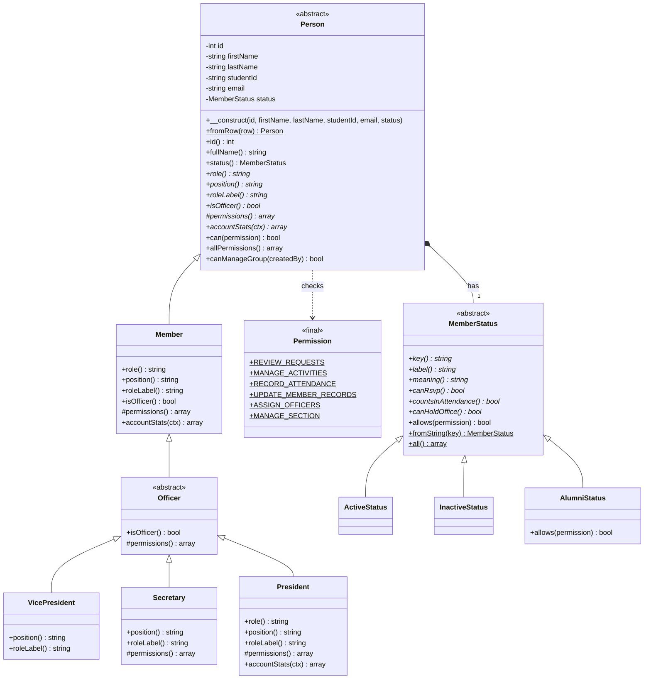
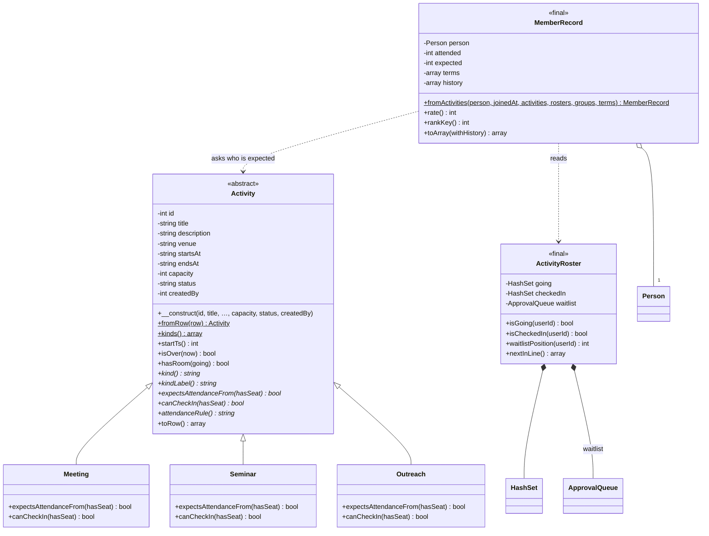
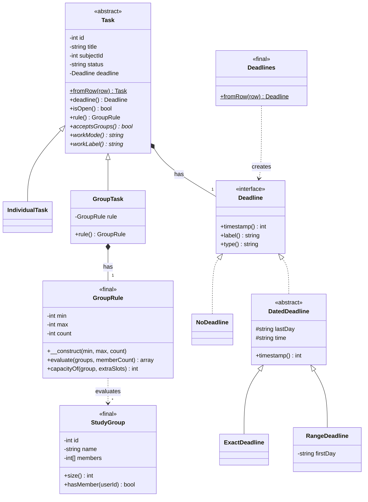
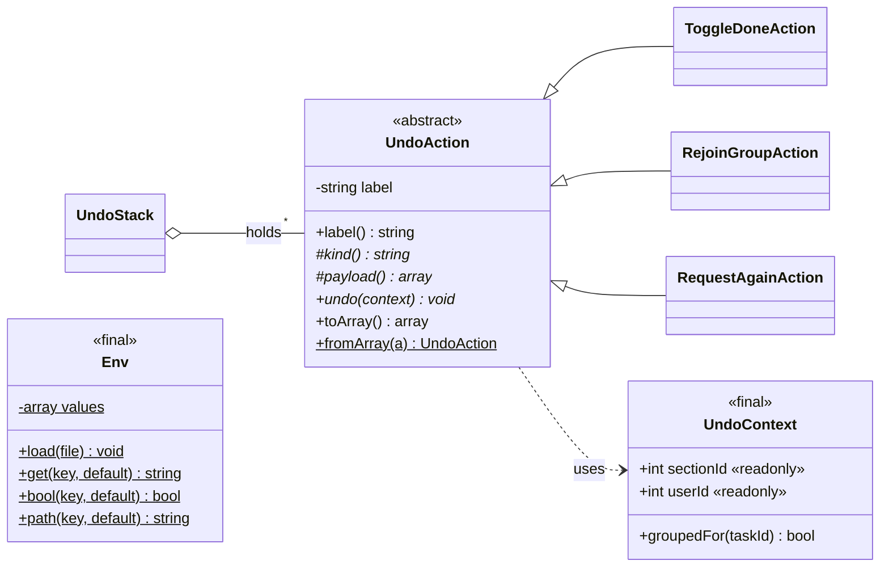
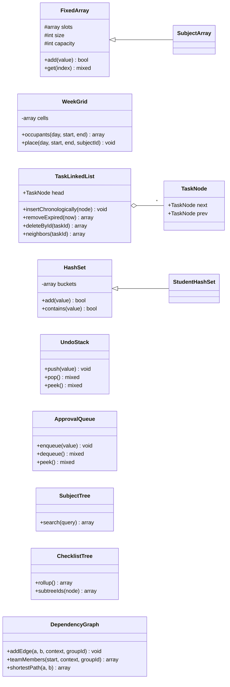

# AcadSync class diagram

The classes below are the ones in `backend/domain/` and `backend/Env.php` (the OOP model) and
`backend/custom_dsa.php` (the data structures), with their real names, fields, methods and visibility.
GitHub draws these diagrams automatically; they can also be pasted into <https://mermaid.live> to
export a PNG for the documentation.

Visibility: `+` public, `-` private, `#` protected. `*` marks an abstract method, `$` a static one.

## 1. People, offices and membership status

## 2. Activities, attendance and member records

## 3. Tasks, deadlines and group work

## 4. Undo (OOP objects kept in a DSA stack) and settings

## 5. Data structures (`backend/custom_dsa.php`)

## Where each pillar is used

| Pillar | Where in the code | What it does in AcadSync |
| --- | --- | --- |
| **Encapsulation** | Private fields + getters in every domain class; `Activity` and `GroupRule` check their values in the constructor and have no setters; `Env` keeps settings in a private array; `UndoContext` uses `readonly` | An invalid activity or group rule can't exist; nothing outside a class can change its data |
| **Inheritance** | `President`/`VicePresident`/`Secretary` → `Officer` → `Member` → `Person`; `Meeting`/`Seminar`/`Outreach` → `Activity`; `GroupTask`/`IndividualTask` → `Task`; the three `MemberStatus` and three `UndoAction` subclasses; `ExactDeadline`/`RangeDeadline` → `DatedDeadline`; `SubjectArray` → `FixedArray`, `StudentHashSet` → `HashSet` | `Officer::permissions()` adds to `parent::permissions()`; `Secretary` and `President` add to `Officer`'s; officers inherit a member's account stats |
| **Polymorphism** | `$person->can()` / `roleLabel()` / `accountStats()`; `$activity->canCheckIn()` / `expectsAttendanceFrom()`; `$status->canRsvp()` / `allows()`; `$task->acceptsGroups()` / `rule()`; `$deadline->timestamp()`; `$action->undo()` | The endpoints never test `role === 'admin'`, the activity kind, `work_mode` or `deadline_type`: each object answers for itself |
| **Abstraction** | `interface Deadline`; `abstract class Person`, `Officer`, `MemberStatus`, `Activity`, `Task`, `DatedDeadline`, `UndoAction` | Callers use what an object can do, not how it does it |

## Relationships

| Relationship | Kind | Meaning |
| --- | --- | --- |
| `Person` ◆— `MemberStatus` | composition | every person has exactly one status; it can hold back permissions (Alumni) |
| `Task` ◆— `Deadline`, `GroupTask` ◆— `GroupRule` | composition | a task owns its deadline and its group rule |
| `ActivityRoster` ◆— `HashSet`, `ApprovalQueue` | composition | going / checked-in sets and the waitlist queue of one activity |
| `MemberRecord` ◇— `Person`, uses `Activity` | aggregation / dependency | a record is built from a person and asks each activity who was expected |
| `UndoStack` ◇— `UndoAction` | aggregation | the DSA stack holds OOP objects that know how to reverse themselves |
| `GroupRule` → `StudyGroup` | association | the rule evaluates a task's groups |
