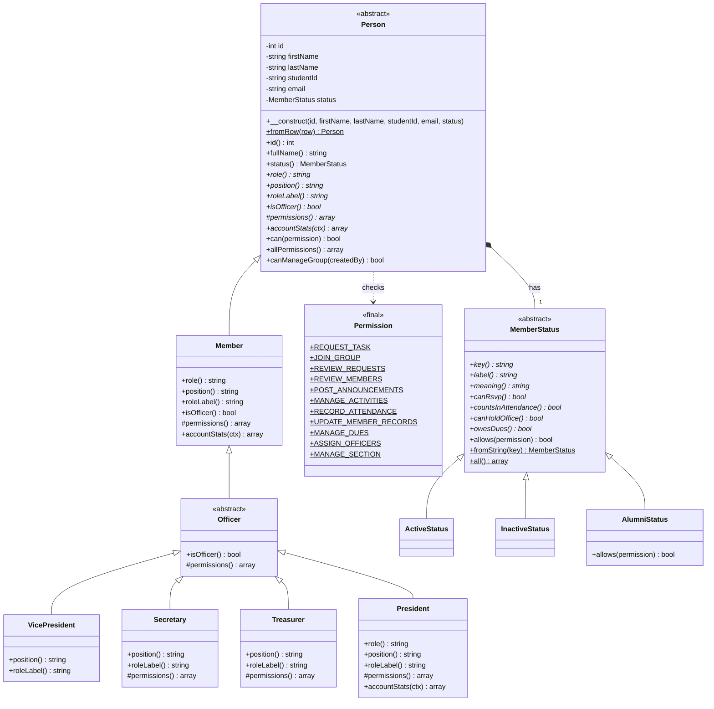
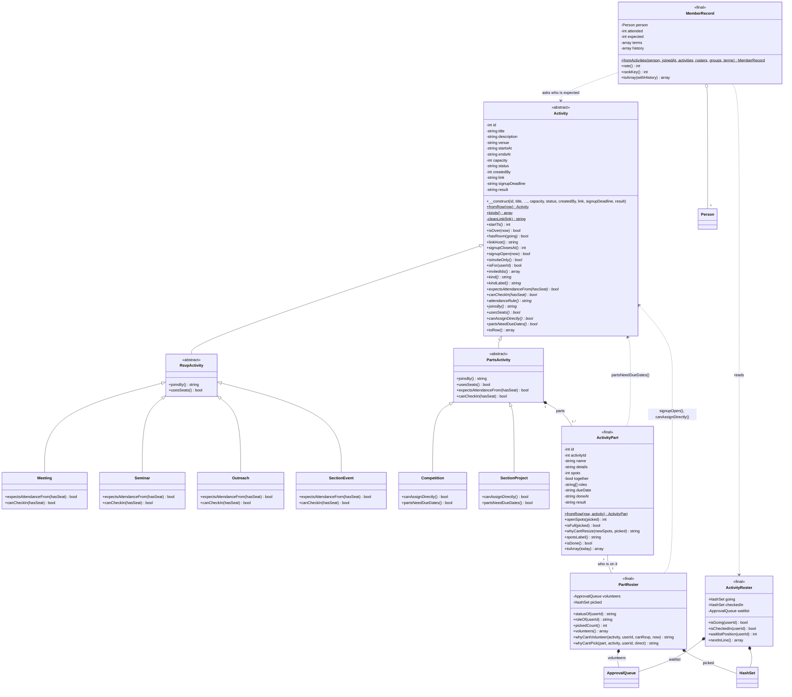
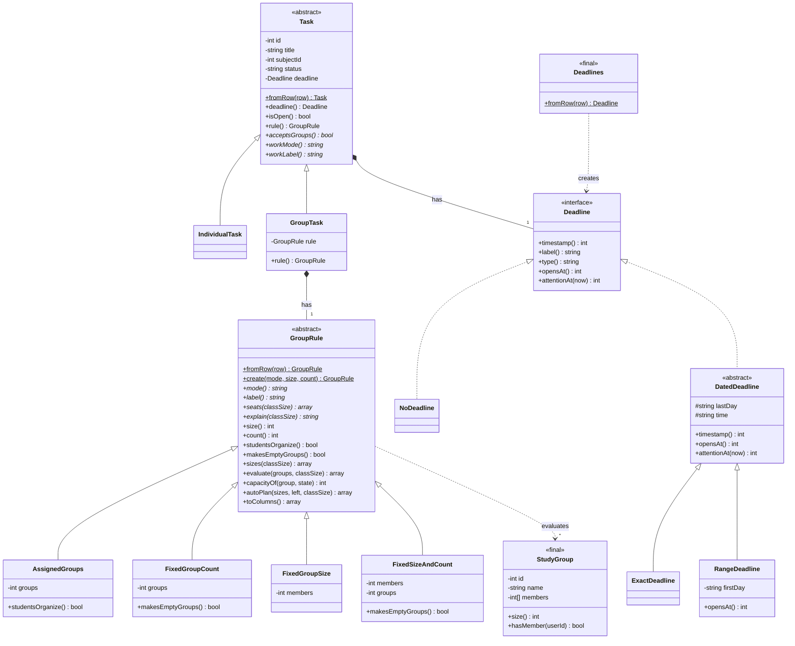
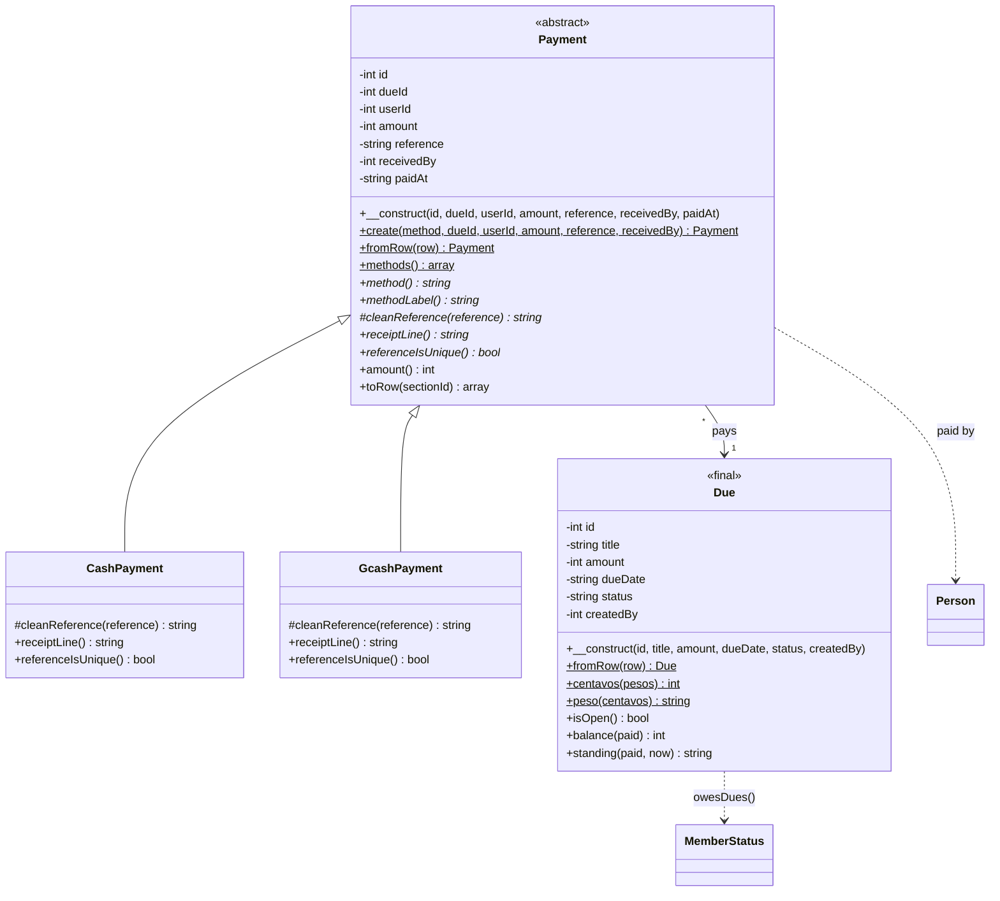
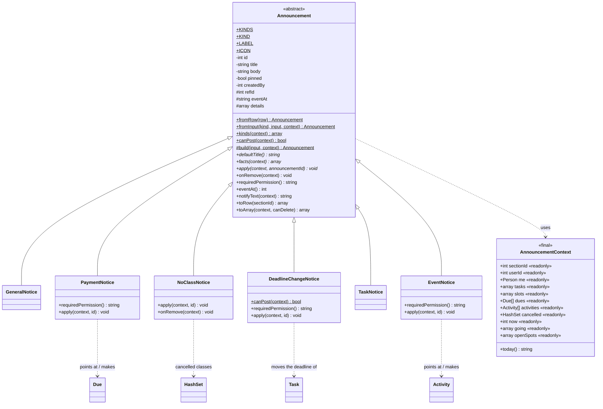
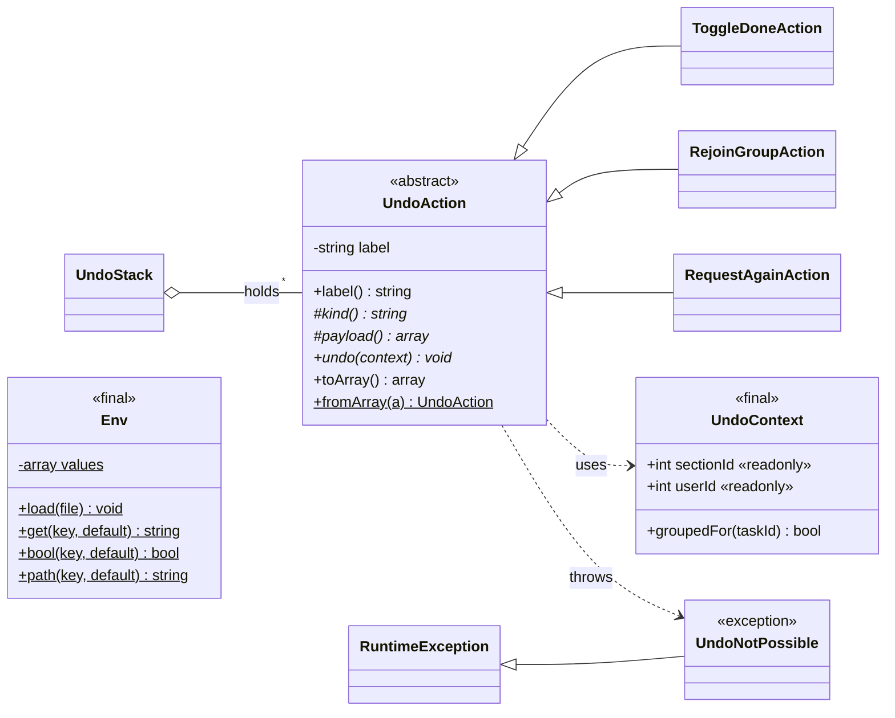
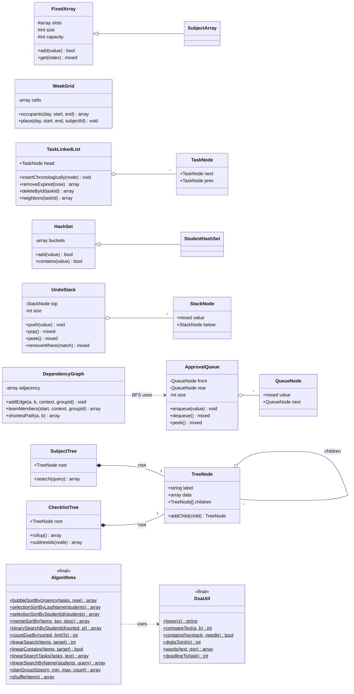

# AcadSync class diagram

The classes below are every class in `backend/domain/` and `backend/Env.php` (the OOP model) and
`backend/custom_dsa.php` (the data structures and algorithms), with their real names, fields, methods
and visibility. Long method lists are shortened to the methods the app relies on.
GitHub draws these diagrams automatically; they can also be pasted into <https://mermaid.live> to
export a PNG for the documentation.

Visibility: `+` public, `-` private, `#` protected. `*` marks an abstract method, `$` a static one.

## 1. People, offices and membership status

## 2. Activities, attendance, competition / project parts and member records

## 3. Tasks, deadlines and group work

## 4. Dues and payments (`backend/domain/Payment.php`)

## 4b. Typed announcements (`backend/domain/Announcement.php`)

Each kind does the real change it announces in `apply()`, inside the same transaction as the post.

## 5. Undo (OOP objects kept in a DSA stack) and settings

## 6. Data structures and algorithms (`backend/custom_dsa.php`)

Every node class is drawn next to the structure that links its nodes.

## Where each pillar is used

| Pillar | Where in the code | What it does in AcadSync |
| --- | --- | --- |
| **Encapsulation** | Private fields + getters in every domain class; `Activity` (title, times, a link that must be http(s), a sign-up deadline on or before the first day), `ActivityPart`, `GroupRule`, `Due` and `Payment` check their values in the constructor and have no setters; money is whole centavos in private fields; `Env` keeps settings in a private array; `UndoContext` uses `readonly` | An invalid activity, group rule, due or payment can't exist; nothing outside a class can change its data |
| **Inheritance** | `President`/`VicePresident`/`Secretary`/`Treasurer` → `Officer` → `Member` → `Person`; `Meeting`/`Seminar`/`Outreach`/`SectionEvent` → `RsvpActivity` → `Activity`; `Competition`/`SectionProject` → `PartsActivity` → `Activity`; `GroupTask`/`IndividualTask` → `Task`; `AssignedGroups`/`FixedGroupCount`/`FixedGroupSize`/`FixedSizeAndCount` → `GroupRule`; `CashPayment`/`GcashPayment` → `Payment`; the six notices → `Announcement`; the three `MemberStatus` and three `UndoAction` subclasses; `ExactDeadline`/`RangeDeadline` → `DatedDeadline`; `SubjectArray` → `FixedArray`, `StudentHashSet` → `HashSet`; `UndoNotPossible` → `RuntimeException` | `Officer::permissions()` adds to `parent::permissions()`; `Secretary`, `Treasurer` and `President` add to `Officer`'s; officers inherit a member's account stats |
| **Polymorphism** | `$person->can()` / `roleLabel()` / `accountStats()`; `$activity->canCheckIn()` / `expectsAttendanceFrom()` / `joinsBy()` / `usesSeats()` / `canAssignDirectly()` / `partsNeedDueDates()` (competitions and projects never touch attendance); `$status->canRsvp()` / `allows()` / `owesDues()`; `$task->acceptsGroups()` / `rule()`; `$rule->seats()` / `explain()` / `studentsOrganize()` (one class per way a prof sets up groups); `$deadline->timestamp()` / `attentionAt()` (an open date range counts as today); `$action->undo()`; `$payment->receiptLine()` / `referenceIsUnique()`; `$announcement->apply()` / `facts()` / `onRemove()` | The endpoints never test `role === 'admin'`, the activity kind, `work_mode`, `deadline_type`, the payment method or the announcement kind: each object answers for itself |
| **Abstraction** | `interface Deadline`; `abstract class Person`, `Officer`, `MemberStatus`, `Activity`, `RsvpActivity`, `PartsActivity`, `Task`, `GroupRule`, `DatedDeadline`, `UndoAction`, `Payment`, `Announcement` | Callers use what an object can do, not how it does it |

## Relationships

| Relationship | Kind | Meaning |
| --- | --- | --- |
| `Person` ◆— `MemberStatus` | composition | every person has exactly one status; it can hold back permissions (Alumni) |
| `Task` ◆— `Deadline`, `GroupTask` ◆— `GroupRule` | composition | a task owns its deadline and its group rule |
| `ActivityRoster` ◆— `HashSet`, `ApprovalQueue` | composition | going / checked-in sets and the waitlist queue of one activity |
| `PartsActivity` ◆— `ActivityPart` | composition | a competition or project owns its parts (at least one) |
| `PartRoster` ◆— `ApprovalQueue`, `HashSet` | composition | a part's volunteers in arrival order and who is picked |
| `ActivityPart` / `PartRoster` → `Activity` | dependency | the part asks its activity for the due-date rule; the roster asks whether sign-ups are open and whether officers may assign directly |
| `MemberRecord` ◇— `Person`, uses `Activity` | aggregation / dependency | a record is built from a person and asks each activity who was expected |
| `UndoStack` ◇— `UndoAction` | aggregation | the DSA stack holds OOP objects that know how to reverse themselves |
| `GroupRule` → `StudyGroup` | association | the rule evaluates a task's groups (seats left, +1 extra seats, who may join) |
| `Payment` → `Due` | association | many payments (part-payments too) settle one due |
| `ApprovalQueue` ◆— `QueueNode`, `UndoStack` ◆— `StackNode`, `TreeNode` ◇— `TreeNode` | composition / aggregation | each structure links its own node objects |
| `Algorithms` → `DsaUtil` | dependency | the sorts and searches use the hand-written text helpers |
